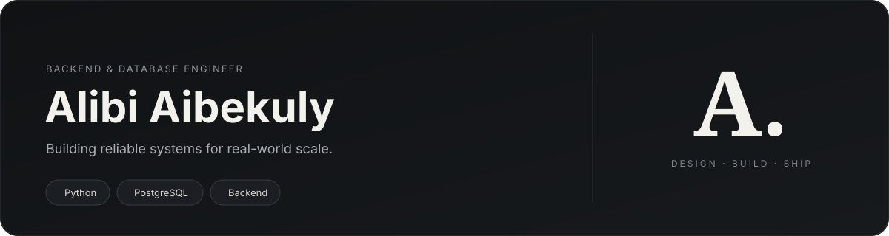
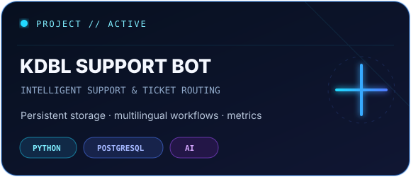
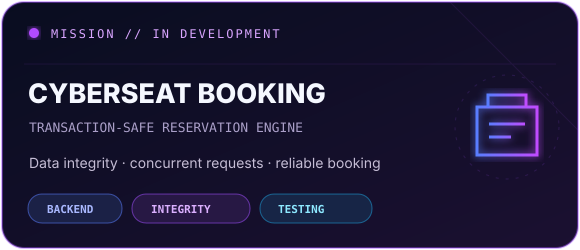
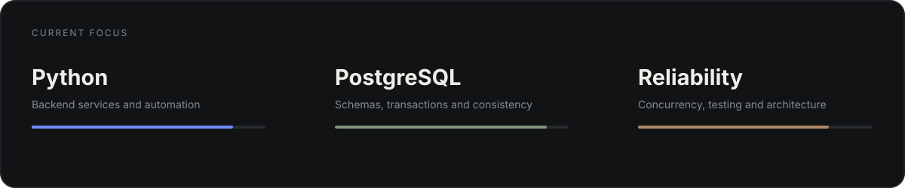

  

  <a href="#01--system-profile"><kbd>01 / PROFILE</kbd></a>&nbsp;
  <a href="#02--tech-core"><kbd>02 / TECH CORE</kbd></a>&nbsp;
  <a href="#03--featured-systems"><kbd>03 / SYSTEMS</kbd></a>&nbsp;
  <a href="#04--verified-track"><kbd>04 / VERIFIED TRACK</kbd></a>&nbsp;
  <a href="#05--control-plane"><kbd>05 / CONTROL PLANE</kbd></a>

<samp>● SYSTEM ONLINE &nbsp; // &nbsp; BACKEND + DATABASE ENGINEERING &nbsp; // &nbsp; BUILDING FOR RELIABILITY</samp>

## 01 // SYSTEM PROFILE

<table>
<tr>
<td width="58%" valign="top">

### MISSION

I build **server-side systems where data must stay correct** — even when many requests arrive at the same time.

My engineering focus is backend logic, relational databases, transactional integrity, API design and concurrency testing. I value clear domain rules, predictable failure modes and systems that remain reliable under real workloads.

</td>
<td width="42%" valign="top">

### CURRENT BUILD

**CyberSeat Booking System**

Shared database · server-side booking engine · record integrity · simultaneous-request testing · double-booking prevention.

**ROLE // BACKEND & DATABASE**

</td>
</tr>
</table>

## 02 // TECH CORE

### PRIMARY

<kbd>PYTHON</kbd>&nbsp; <kbd>SQL</kbd>&nbsp; <kbd>POSTGRESQL</kbd>&nbsp; <kbd>FASTAPI</kbd>

### DATA & RELIABILITY

<kbd>TRANSACTIONS</kbd>&nbsp; <kbd>DATA INTEGRITY</kbd>&nbsp; <kbd>CONCURRENCY</kbd>&nbsp; <kbd>PYTEST</kbd>&nbsp; <kbd>REDIS</kbd>

### ENGINEERING TOOLCHAIN

<kbd>DOCKER</kbd>&nbsp; <kbd>GIT</kbd>&nbsp; <kbd>LINUX</kbd>&nbsp; <kbd>JAVA</kbd>&nbsp; <kbd>REST API</kbd>

## 03 // FEATURED SYSTEMS

<table>
<tr>
<td width="50%" align="center" valign="top">

  
<a href="https://github.com/Alibi-stack/KDBL-Support-Bot"><kbd>OPEN REPOSITORY ↗</kbd></a>
</td>
<td width="50%" align="center" valign="top">

  
<a href="https://github.com/NeryBR/cyberseat-booking-system"><kbd>OPEN REPOSITORY ↗</kbd></a>
</td>
</tr>
</table>

## 04 // VERIFIED TRACK

My recent Coursera work follows one connected path: **architecture → databases → microservices → reliability → security → testing**.

<table>
<tr><td><strong>MICROSERVICES ARCHITECTURE</strong> Design Patterns & Principles · Packt</td><td align="right"><a href="https://www.coursera.org/account/accomplishments/specialization/YKVLXQQ2C1HJ"><kbd>VERIFY ↗</kbd></a></td></tr>
<tr><td><strong>SOFTWARE DESIGN & ARCHITECTURE</strong> University of Alberta</td><td align="right"><a href="https://www.coursera.org/account/accomplishments/specialization/BUV5BI780IN7"><kbd>VERIFY ↗</kbd></a></td></tr>
<tr><td><strong>ENTERPRISE ARCHITECTURE WITH .NET</strong> Packt</td><td align="right"><a href="https://www.coursera.org/account/accomplishments/specialization/VL616R0HBXQZ"><kbd>VERIFY ↗</kbd></a></td></tr>
<tr><td><strong>CLOUD INFRASTRUCTURE & PLATFORMS</strong> Illinois Tech</td><td align="right"><a href="https://www.coursera.org/account/accomplishments/specialization/RYHWHFYT36CL"><kbd>VERIFY ↗</kbd></a></td></tr>
<tr><td><strong>IT FUNDAMENTALS FOR CYBERSECURITY</strong> IBM</td><td align="right"><a href="https://www.coursera.org/account/accomplishments/specialization/D2OIUXNZDHZ5"><kbd>VERIFY ↗</kbd></a></td></tr>
</table>

## 05 // CONTROL PLANE

  

  <a href="https://github.com/Alibi-stack?tab=repositories"><kbd>EXPLORE ALL REPOSITORIES</kbd></a>&nbsp;
  <a href="https://github.com/Alibi-stack/KDBL-Support-Bot"><kbd>VIEW PYTHON SYSTEM</kbd></a>&nbsp;
  <a href="https://github.com/NeryBR/cyberseat-booking-system"><kbd>VIEW CURRENT MISSION</kbd></a>

 

  

